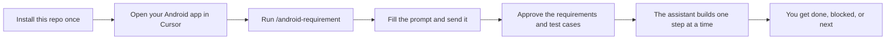
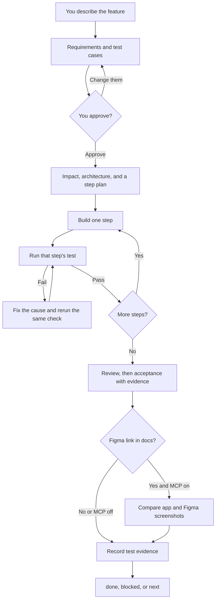
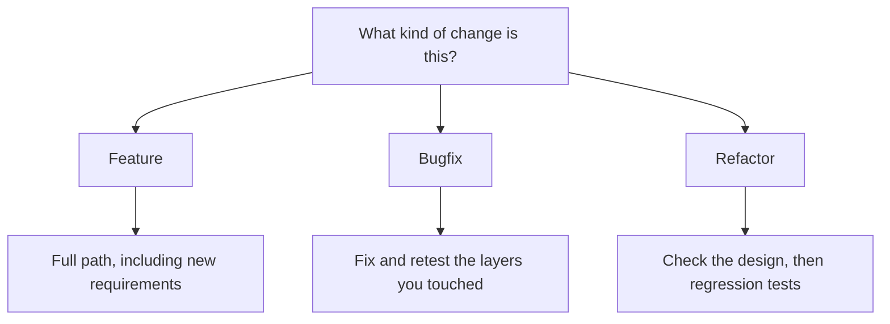
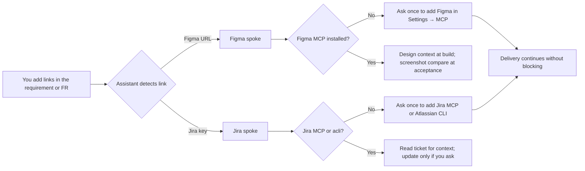
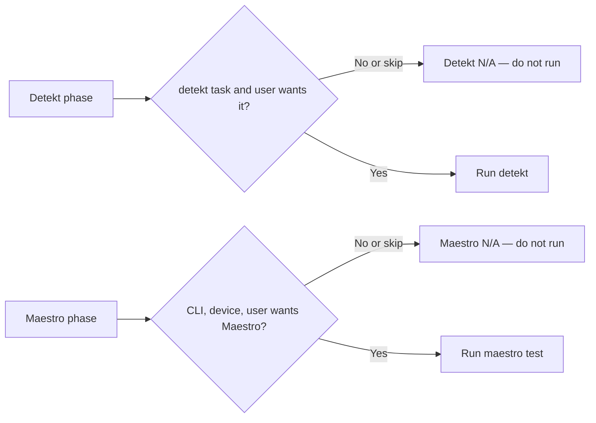
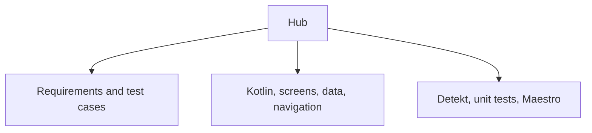

# Android Agentic Orchestrator

This repo is a set of instructions for [Cursor](https://cursor.com). Install it once. Then, in an Android app, describe a feature and the assistant follows a fixed path: write the requirements, wait for your approval, build one small step at a time, and show test evidence before it calls the work done.

It is for **Kotlin Android** apps. Kotlin Multiplatform stays on separate `kmm-*` skills.

The detailed catalog is in [INDEX.md](INDEX.md). Version history is in [CHANGELOG.md](CHANGELOG.md).

## Use it



1. Install the pack (commands below) and open a **new** Agent chat.
2. In your Android app, run `/android-requirement`. Copy the prompt it prints.
3. Fill the required parts: what the user gets, why, who, the happy path, what “done” looks like, and what is in or out of this slice.
4. Send that prompt. The assistant writes `docs/functional-requirements.md` and `docs/test-cases.md` (positive, negative, and edge cases for each requirement).
5. Read them and reply **approve FR** when they match what you want. Coding waits for that.
6. The assistant then plans the work and builds **one step at a time**. Each step names the files, the tests, and the command that proves the step.
7. The chat ends with **done**, **blocked**, or **next**, plus the command output. A build that only compiles is not done.

If you already have `docs/implementation-plan.md`, say so. The assistant checks that plan and fills gaps. A plan that is already enough stays as it is.

## What a feature looks like



On a failed check, the assistant classifies the cause, fixes that layer, and reruns the same command. The same failure three times, with nothing new learned, stops the loop and returns **blocked**.

## Three kinds of work



| Kind | What you get | What can be shorter |
|------|----------------|---------------------|
| **Feature** | Requirements, test cases, plan, build, checks, review, retrospective | Nothing |
| **Bugfix** | A short impact note, the fix, and checks for the code you touched | A new requirement, when the existing acceptance criteria already cover the bug |
| **Refactor** | An architecture check, the change, and regression tests | A new product requirement |

## What gets written in your app

| File | What it is |
|------|------------|
| `docs/functional-requirements.md` | What the feature must do. Stays a draft until you approve it. |
| `docs/test-cases.md` | Positive, negative, and edge cases for each requirement. |
| `docs/requirement-impact.md` | What else the change touches. |
| `docs/implementation-plan.md` | One row per step: files, tests, and the command that proves it. |
| `docs/testing-strategy.md` | Which cases run as small tests, and which few run on a device. |
| `docs/acceptance-criteria.md` | Proof from a run after the last code change. |
| `docs/retrospective.md` | What to remember next time. |

Optional fields in the requirement and FR templates hold **Figma** frame links and a **Jira** issue key. Neither is required.

## Optional: Figma and Jira



| Tool | What it adds | If you skip it |
|------|----------------|----------------|
| **Figma MCP** | Reads frames while building UI; at acceptance, compares Figma and app screenshots | UI follows FR and tests only; acceptance notes **Figma compare: skipped** |
| **Jira MCP or `acli`** | Pulls issue summary into the FR **Tracking** section | Keep the issue key in docs manually |

Install MCP servers under **Cursor Settings → MCP**. When the assistant prompts you, it should include the matching steps from [setup-guides.md](skills/android/android-orchestrator/references/setup-guides.md) (Figma, Jira/`acli`, Detekt, Maestro). Overview: [optional-mcp.md](skills/android/android-orchestrator/references/optional-mcp.md).

## Detekt and Maestro (optional quality gates)

The assistant asks once whether you use Detekt or Maestro. If a tool is **not set up** or you **skip** it, that gate is **not run** — the lane continues with build and unit tests (and other checks that still apply). Status shows **N/A** with a short reason, not **blocked**.



| Tool | When it runs | When it is skipped |
|------|----------------|-------------------|
| **Detekt** | Project has a `detekt` Gradle task and you did not skip it | No plugin yet, or you chose not to use Detekt |
| **Maestro** | CLI installed, device ready if needed, and you did not skip it | CLI not installed, no device and you skip Maestro, or you chose not to use Maestro |

Full behavior: [quality-tooling.md](skills/android/android-orchestrator/references/quality-tooling.md). Step-by-step install guides (shown when the assistant asks you to set up a tool): [setup-guides.md](skills/android/android-orchestrator/references/setup-guides.md).

## How the assistant stays focused

One **hub** (`android-orchestrator`) runs the whole path. It opens a **spoke** only when that file or step needs it. A Compose screen does not pull in database or UI-test instructions.



Before an edit, the hub looks at three things and loads each matching skill once:

1. **File** — the path being edited ([file-routing.yml](skills/android/android-orchestrator/references/file-routing.yml)).
2. **Task** — signals such as paging, deep links, or auth ([task-routing.yml](skills/android/android-orchestrator/references/task-routing.yml)).
3. **Phase** — the current step. The table in [INDEX.md](INDEX.md) matches the hub.

## Install

Copy the skills into `~/.cursor/skills/android/`. The destination folder must already exist, or `cp -R` nests the tree in the wrong place. Replacing the folder drops skills that were renamed or removed upstream.

```bash
git clone https://github.com/Kapil-SquareNetra/android-agentic-orchestrator.git
cd android-agentic-orchestrator
mkdir -p ~/.cursor/skills ~/.cursor/rules ~/.cursor/commands
rm -rf ~/.cursor/skills/android
cp -R skills/android ~/.cursor/skills/
cp rules/*.mdc ~/.cursor/rules/
cp commands/*.md ~/.cursor/commands/
```

Open a new Agent chat so Cursor picks up the copy. After you pull updates, run the copy again. Cursor does not watch this git repo.

For one Android app, also copy the project pointer. This overwrites an existing `AGENTS.md`.

```bash
mkdir -p /path/to/android-app/.cursor/rules
cp rules/*.mdc /path/to/android-app/.cursor/rules/
cp skills/android/android-orchestrator/assets/AGENTS.md /path/to/android-app/AGENTS.md
```

Optional: copy `file-routing.yml` and `task-routing.yml` into that app’s `.cursor/routing/`. The skill pack stays the source of truth.

The app needs a Gradle wrapper. Detekt and Maestro are optional; add them when you want those gates. If you use cloud agents, enable **Sync Skills for Cloud Agents** in Cursor Settings.

The assistant asks before destructive actions: `git push`, signing or keystore edits, committing `local.properties` or secrets, deleting Room migrations, and `adb uninstall`.

## First time on an existing app

Read [new-project-init.md](skills/android/android-orchestrator/references/new-project-init.md). It lists what to inspect (modules, architecture, Detekt, tests) and the rule to fit the app’s current design.

Gradle defaults assume a single `:app` module. Override module names and commands in the project `AGENTS.md`. See [quality-commands.md](skills/android/android-orchestrator/references/quality-commands.md).

## What is in this repo

| Piece | Role |
|-------|------|
| `skills/android/android-orchestrator` | Hub. Starts from its description. Owns the path, the definition of done, and routing. |
| Other `skills/android/android-*` | Spokes. The hub reads them when the step or file needs them. |
| `commands/android-requirement.md` | Slash command `/android-requirement`. Prints the prompt you fill in. |
| `android-figma`, `android-jira` | Optional spokes for design and ticket traceability. |
| `rules/*.mdc` | Optional file rules for an Android app. |
| `scripts/validate_pack.py` | Checks that the pack is still consistent. |
| `skills/.../references/setup-guides.md` | Install steps for Figma, Jira, Detekt, and Maestro (shared when the assistant asks). |

```text
INDEX.md                     Phases and skill catalog
README.md                    This file
CHANGELOG.md                 Version history
skills/android/              Hub and spokes
commands/                    Slash commands
rules/                       Optional Cursor rules
scripts/                     Pack checks
examples/                    Smoke checklist
```

## Check the pack

```bash
python3 -m pip install pyyaml   # Python 3.9+; CI uses 3.12
python3 scripts/validate_pack.py
```

A good run prints `validate_pack: OK`. CI runs the same check on pushes to `main` and on pull requests ([`.github/workflows/validate.yml`](.github/workflows/validate.yml)).

After install, walk [examples/smoke-checklist.md](examples/smoke-checklist.md): the hub attaches first, a Compose edit loads `android-compose`, and a real Detekt and unit-test run shows up in the final status.

## License

MIT — see [LICENSE](LICENSE).
